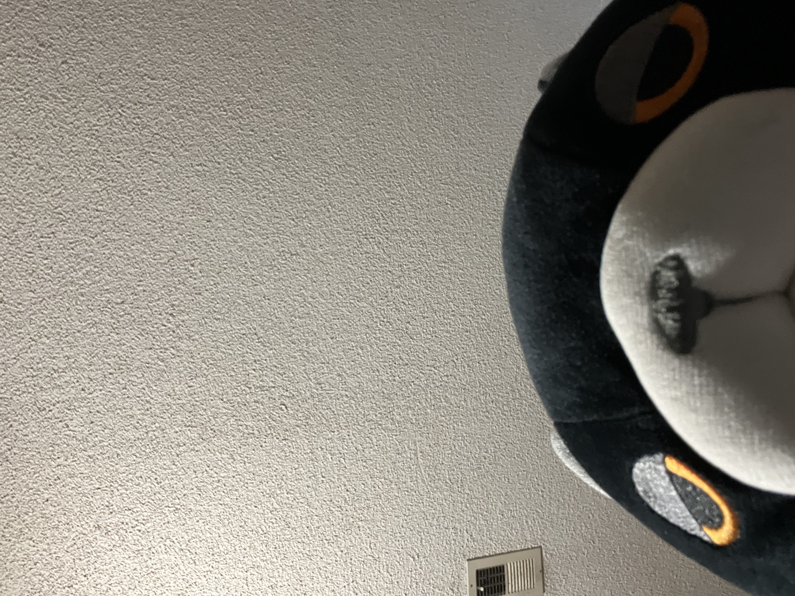

# MrHenderson


MrHenderson is a C++ UCI chess engine. He likes naps and tuna fish.

## Features

- Legal move generation with castling, promotion, and en passant
- FEN and UCI `position` parsing
- Iterative deepening alpha-beta search
- Quiescence search for tactical stability
- Transposition table with configurable hash size
- Repetition and fifty-move draw detection with history-aware transposition scores
- Capture, killer, history, and promotion move ordering
- Simple material, piece activity, pawn-structure, and king-safety evaluation
- MrHenderson style: modest preference for captures and simplification when
  ahead, with shorter searches in clearly winning clock-controlled positions
- Catalan-friendly opening bias through small tie-break bonuses for `d4`,
  `c4`, `g3`, `Nf3`, and `Bg2` setups

## Personality Options

MrHenderson exposes a few UCI options that let a GUI or `lichess-bot` tune his
character without turning him into a joke engine:

```text
Personality: Balanced, Sleepy, Hungry, or Grumpy
Nap Threshold: centipawn lead before he starts saving time
Tuna Mode: capture/simplification preference from 0 to 100
Chatty: Off, Rare, or Normal
```

The default personality is `Sleepy`: he likes Catalan structures, takes pieces
when the position allows it, simplifies winning positions, and spends a little
less time when the win is comfortable.

Personality choices stay within a small verified evaluation margin of the best
move. Forced mates take priority over style. Naps require a stable advantage
across consecutive completed searches, and never start while he is in check.

## Build your own Mr. Henderson

With CMake:

```powershell
cmake -S . -B build -DCMAKE_BUILD_TYPE=Release
cmake --build build --config Release
```

With MinGW Make:

```powershell
mingw32-make
```

Or directly with MinGW:

```powershell
g++ -std=c++17 -O3 -DNDEBUG src/main.cpp -o MrHenderson.exe
```

## Search tests

The CMake build includes regression tests for move generation, quiescence mates
and stalemates, draw history, transposition scores, and personality move safety:

```powershell
ctest --test-dir build -C Release --output-on-failure
```

To compare a saved older executable with the new build, install `python-chess`
for the optional match runner. The engine itself has no Python dependency.

```powershell
python -m pip install python-chess
python tools/compare_engines.py baseline.exe build/MrHenderson.exe --games 40 --movetime 0.15 --jobs 2 --output build/comparison-fast
python tools/compare_engines.py baseline.exe build/MrHenderson.exe --games 8 --clock 30 --increment 0.2 --jobs 2 --output build/comparison-clock
```

For multi-configuration generators, use `build/Release/MrHenderson.exe` instead.
Both engines use their default personality and a 64 MiB hash. The runner reverses
colors for each opening and saves JSON results and PGNs. A game that reaches
the move cap stays unfinished and is excluded from the score. These matches
measure progress against the saved version; they do not establish a public Elo.

## Quick UCI Test

```text
uci
isready
position startpos moves e2e4 e7e5
go depth 5
quit
```

The engine should answer with `uciok`, `readyok`, search `info` lines, and a
final `bestmove`.

## Lichess Henderson

MrHenderson is a UCI engine. You can connect him with
[`lichess-bot`](https://github.com/lichess-bot-devs/lichess-bot). In your
`lichess-bot` config, point the engine path at the compiled executable.

For the verified MinGW Make or direct `g++` build:

```yaml
engine:
  dir: C:\path\to\Chess-Engine
  name: MrHenderson.exe
  protocol: uci
```

If you build with CMake, use the CMake output directory instead, usually
`C:\path\to\Chess-Engine\build`.

Example `lichess-bot` setup:

Create a Lichess OAuth token with the `bot:play` scope. Keep it out of source
control by setting it as an environment variable, then run:

```powershell
cd C:\path\to\lichess-bot
$env:LICHESS_BOT_TOKEN = "your_token_here"
python lichess-bot.py --config config.yml -u
python lichess-bot.py --config config.yml -v
```

The `-u` command upgrades the account to a bot account. This is irreversible
and only works for an account that has not already played games.

Use it only with a bot account or in contexts where engine assistance is
allowed by the site rules.

The local `lichess-bot` setup can also announce Mr Henderson's little naps in
chat when the engine reports a comfortable advantage.
